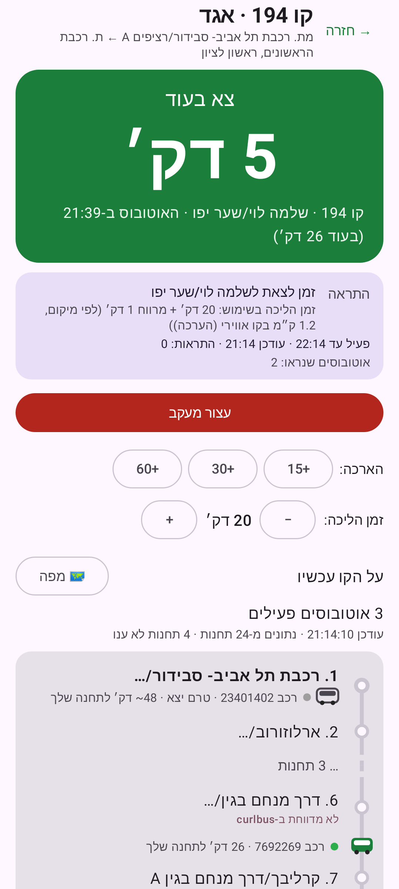
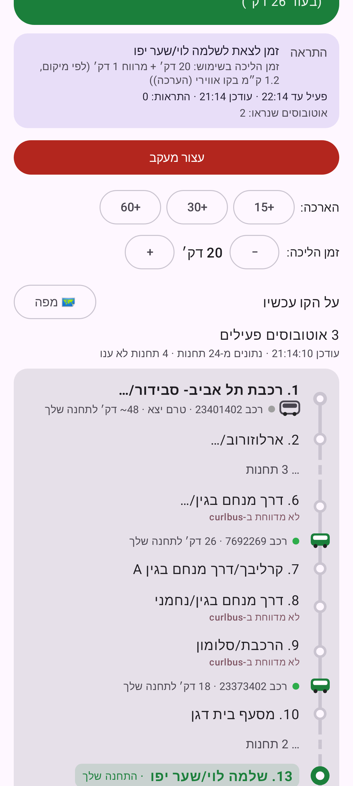
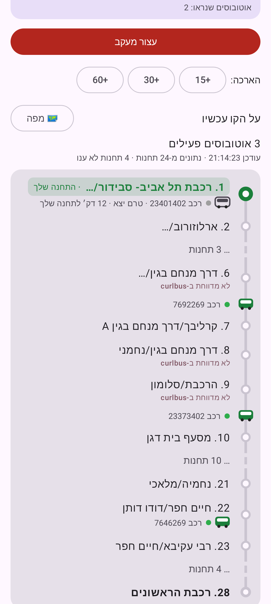

# kav-monitor-il

[](https://github.com/ofirdadonx/kav-monitor-il/actions/workflows/ci.yml)

Hebrew Android app (מעקב קו) for Israeli bus lines. Pick a line and direction, then get a loud notification when the bus leaves its origin, reaches a stop you choose, or when it is time to leave home to catch it.

Each watch runs in the foreground for a limited time (default 60 minutes). The last five setups are kept as one-tap recents.

<p align="center">
  
  
  
</p>

Screenshots are from 0.6. The current release is **0.7** (Material 3). See [CHANGELOG.md](CHANGELOG.md).

## Features

- Search a line, pick a direction, and watch one of three triggers: departs origin, arrives at a stop, or time to leave.
- Live route view: stop diagram, bus position, and minutes to your stop.
- Nearby stops and a map while the app is open.
- Follow one bus. Broken curlbus stops fall back to neighbouring stops.
- Walk time for “time to leave” (straight-line estimate, adjustable). Optional walking route when a routing key is set.
- Hebrew UI, right-to-left.

## Requirements

- JDK 21+ (the UI tests run Robolectric on Android SDK 36, which needs 21)
- Android SDK, compile/target 37 (`ANDROID_HOME` or `sdk.dir` in `local.properties`)
- Device or emulator on Android 8.0+ (minSdk 26)

## Build

```bash
./gradlew :androidApp:assembleDebug
```

The APK is copied to `androidApp/build/outputs/named/kav-monitor-0.7.apk`. It is a debug build, signed with the local debug key. Install with `adb install -r` on that file, or copy it to the phone.

Release signing uses `KAV_KEYSTORE`, `KAV_KEYSTORE_PASSWORD`, `KAV_KEY_ALIAS`, and `KAV_KEY_PASSWORD`. Without them, `assembleRelease` stays unsigned.

## CI and releases

Pull requests and pushes to `main` run the unit tests and a debug build (`.github/workflows/ci.yml`).

Pushing a tag `v<version>` publishes a signed APK on [GitHub Releases](https://github.com/ofirdadonx/kav-monitor-il/releases). The tag has to match `versionName` in `androidApp/build.gradle.kts` and a `## <version>` section in [CHANGELOG.md](CHANGELOG.md). The release job needs these repository secrets: `KAV_KEYSTORE_BASE64`, `KAV_KEYSTORE_PASSWORD`, `KAV_KEY_ALIAS`, `KAV_KEY_PASSWORD`.

## Tests

```bash
./gradlew :shared:jvmTest
./gradlew :androidApp:testDebugUnitTest
```

Live checks against [Open Bus Stride](https://open-bus-stride-api.hasadna.org.il) and [curlbus](https://curlbus.app):

```bash
./gradlew :shared:liveSmoke
./gradlew :shared:routeLiveSmoke
./gradlew :shared:leaveLiveSmoke -PstopCode=36926 -PwalkMinutes=6 -Pminutes=60
```

## How it works

Kotlin Multiplatform and Compose Multiplatform. Only Android is shipped. Shared code is in `shared/`; the app shell, foreground `WatchService`, and notifications are in `androidApp/`.

| Data | Source |
|---|---|
| Line directions and stop lists | Open Bus Stride (GTFS) |
| Live visits and nearby stops | curlbus |

The watch polls about once a minute. The route view polls only while that screen is visible. Thresholds live in `shared/src/commonMain/kotlin/il/kavmonitor/shared/trigger/TriggerConfig.kt`.

## Limits

- curlbus is a community service. Some stops return HTTP 500. A watched stop that stays broken has no exact-stop fallback.
- GPS fixes are sparse, so arrival alerts are roughly within a minute.
- “Time to leave” uses a straight-line walk unless a routing key is configured. Walk time does not update in the background.
- An alert that already fired is not repeated if the ETA later shifts.

Design measurements and trigger rules: [docs/design-notes.md](docs/design-notes.md).
